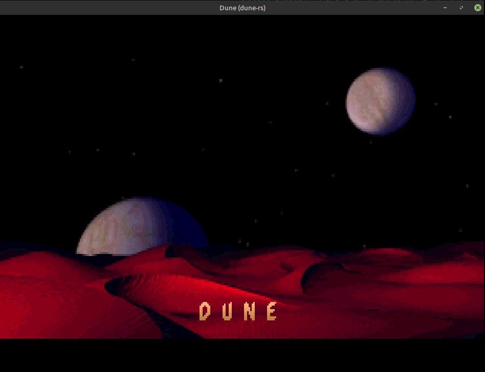

# Dune-rs

A Rust re-implementation of the engine of Cryo's **Dune** (1992, CD version 1993),
built by reverse-engineering `DNCDPRG.EXE` and the `DUNE.DAT` archive.

It contains **no game data**. You need your own copy of the CD: point the engine at `DUNE.DAT`.



## Layout

| crate | what |
|---|---|
| `crates/dune-formats` | Readers for the original formats: `DUNE.DAT`, HSQ compression, palettes, sprite sheets, HNM video, VOC audio, string tables, font. |
| `crates/dune-tools`   | `dune-tool`: list/extract the archive, export sprites and video frames to PNG, sounds to WAV, text to UTF-8. |
| `crates/dune-engine`  | `dune`: the SDL2 engine (intro playback with sound, resource explorer, game modes as they get reversed). |
| `docs/formats.md`     | Byte-level format notes. |
| `docs/re/`            | Reverse-engineering notes on the executable (rooms, game flow, music driver). |

## Build & run

Requires Rust and SDL2 (`libsdl2-dev` / `SDL2-devel` / `sdl2`).

```sh
cargo build --release
# DUNE.DAT is the big file at the root of the CD (or inside Dune.iso)
target/release/dune /path/to/DUNE.DAT            # English text
target/release/dune /path/to/DUNE.DAT --fr       # French (--de --it --es, or --lang 1..7)
target/release/dune /path/to/DUNE.DAT --skip-intro
```

Simplest: put `DUNE.DAT` and `DNCDPRG.EXE` in a `datas/` folder next to the `dune` binary
(e.g. `target/release/datas/`) and just run `dune`. `DUNE_DAT=/path/to/DUNE.DAT` or a path
argument also work. Note that `cargo clean` deletes `target/`, including `datas/`.

Keys: during the intro `Esc` jumps into the game, any other key goes to credits + prologue
(as in the original). In game: arrows or the compass move between rooms, click a command
line (or press `1`–`5`), click a character to talk, `Space`/click advances speech, `Q` quits.
`F1` toggles the resource explorer (`Tab` switches Sprites / Videos / Text / Sounds, arrows
navigate, `Enter` plays, `P`/`O` cycles the base palette, `1`–`7` language).
`DNCDPRG.EXE` must sit next to `DUNE.DAT`: the engine reads the game's static tables from it.

The globe, maps and travel screens are mouse-driven like the original; keyboard equivalents
(also used by the headless `--key` scripts):

| screen | keys |
|---|---|
| SEE DUNE MAP | arrows scroll (compass arrows), `c` re-centre, `g` globe button, `Tab` click the next place icon, `Enter` click it again, `Esc` cancel the popup |
| globe | `Up`/`Down` tilt, `Left`/`Right` rotate (the four arrows), `c` centre on Paul, `x` EXIT GLOBE, `Enter` click the middle of the disc (map of that area), `m` toggle the "SEE MAP OF THIS AREA" hover menu |
| destination map (ornithopter / worm) | `Tab` point at the next place, `n`/`e`/`s`/`w` point at a desert direction, `Enter` click, arrows scroll, `c` re-centre, `Esc` cancel |
| flight with manual steering | `Left`/`Right` turn, `Up` RESUME FLIGHT |
| desert | arrows walk (compass) |

Debug: `--place HEX` starts in a room (ds:4 value); `DUNE_START_LOC=n` (decimal) picks the
location record for it; `DUNE_POKE=addr:val,...` patches ds: bytes at start (e.g.
`DUNE_POKE=2a:50` enables CALL A WORM); `DUNE_SEED=hex` fixes the three RNG seeds;
`DUNE_SLOT_TICKS=n` shortens a time slot (12000 ticks) for captures; `DUNE_DEBUG=1` logs journey
steps. On the map, `t` / `r` left / right-click the next own troop icon and `f` clicks the
SEE SPICE DENSITY footer (mode switch).

## Status

| Area | State |
|---|---|
| Archive, HSQ, sprites, palettes, fonts, text, VOC | done, tested on the whole archive |
| HNM video (frame rates, `sd` audio sync, dot-grid FMVs, subtitles) | done |
| AdLib music (HERAD driver port + Nuked-OPL3) | done; song lengths match the driver |
| Intro / attract loop, credits, narrated prologue | done except the in-engine scenes and transition effects |
| Rooms (`.SAL`: sprites, scaling, flips, gradient/noise polygons, lines) | done |
| Palace navigation (exits, locked doors), UI panel, clock | done |
| Characters in rooms, talk menu, dialogue conditions, voices | done (talking face close-ups / lip-sync not yet) |
| Globe (rotation, results view), Dune map, desert walking, ornithopter flight + landings, worms | done |
| Spice harvesting, troops, Harkonnen simulation, battles, endings | done: `sim.rs` (byte-exact against the original per-slot code, see `sim/tests.rs`), orders / map layer `troop_ui.rs`, war / game overs / ending `war_ui.rs`, dialogue machinery `talk.rs` |
| Save/load, mirror | done |
| Day/night palette fades, sietch water ripple, book | done except the book |


### Tools

```sh
dune-tool DUNE.DAT list
dune-tool DUNE.DAT extract out/            # HSQ decompressed (--raw to keep as stored)
dune-tool DUNE.DAT sprites png/ [NAME...]  # contact sheets
dune-tool DUNE.DAT frames IRULAN.HNM frames/ 10
dune-tool DUNE.DAT wav 'PA\PA190I.VOC' line.wav
dune-tool DUNE.DAT text PHRASE21.HSQ
```

### Tests

```sh
cargo test                                     # unit tests
DUNE_DAT=/path/to/DUNE.DAT cargo test          # + full-archive checks against your data
```
